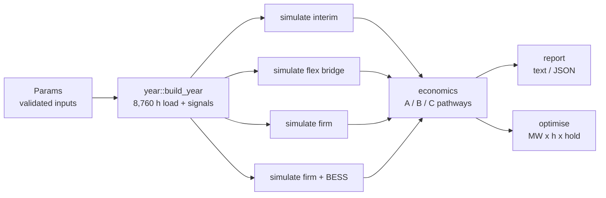

# firmgap — Interim Non-Firm Grid Energization & Curtailment Economics for AI Data Centers

[](https://github.com/kakashi3lite/firmgap/actions/workflows/ci.yml)
[](https://github.com/kakashi3lite/firmgap/actions/workflows/codeql.yml)
[](https://scorecard.dev/viewer/?uri=github.com/kakashi3lite/firmgap)
[](LICENSE)


**firmgap** prices the *firm gap*: the months, sometimes years, between an **interim non-firm
interconnection** and **firm grid service** for a large flexible load such as an **AI inference /
GPU data center**. It's an hour-by-hour (8,760 h) **curtailment and demand-response simulator** with a
**BESS sizing optimizer**. It shows whether a **battery energy storage system**, on-site gensets and
**deferrable batch compute (workload throttling / load flexibility)** can keep a campus under a
utility's curtailment ceiling, pass a **sub-5-minute response test**, respect **compute SLAs**, and
beat the **interconnection-queue delay cost** of waiting.

The project ships two front ends:
* a dependency-free **Rust library + CLI** (`firmgap`);
* a single-file **interactive web simulator** (`web/index.html`), which is also the numerical
  reference that the Rust kernel is tested against.

> Built from the *KilowattBridge Compute* case study: a 45 MW campus, a 38-month firm queue, and a
> 22 MW interim non-firm offer. The case numbers are the defaults, so every result in this README is
> reproducible with `firmgap run`.

---

## Why it matters

In some US markets, transmission-constrained zones now quote multi-year cluster studies and network
upgrades for large loads. Utilities and ISOs are answering with *flexible / non-firm* service:
interconnect sooner if the load agrees to curtail. Examples include Texas SB 6 curtailment equipment
for large loads, PJM's non-capacity-backed load discussion, and Google's ML-workload
demand-response agreements. Research (Duke Nicholas Institute, 2025) estimates **76 GW** of new load
could fit on the existing US grid if it accepted curtailment for 0.25% of its uptime. Sources and
caveats are in [docs/VERIFICATION.md](docs/VERIFICATION.md).

Finance and engineering usually model this separately. firmgap puts **queue carry, curtailment
penalties, BESS CapEx, genset permits and SLA risk in one hourly model**.

## Results on the case study (verified, reproducible)

v0.2 adds an investor layer (full-life NPV, downside, weather-year Monte Carlo, stress worlds) and
realistic engineering derates. The **Base Case** is the case-study inputs plus a 0.5 MW control
deadband, a 90% usable SoC window, 95% BESS availability and $25/MWh deferral fees. Gross margin is
an assumed $320/MWh before energy, with its break-even reported alongside.

| Design | BESS CapEx | Compliant weather years | NPV vs. interim-only | Downside (test fails) |
|---|---|---|---|---|
| **Robust hybrid 18.5 MW / 2 h, 12 h hold** | **$12.9M** | **100%** | **$66.6M** | −$11.1M |
| v0.1 optimum 13.5 MW / 2 h | $9.4M | 0% (fails the first-minutes test) | −$8.1M | −$8.1M |
| Engineering proposal 23 MW / 4 h, 4 h hold | $26.2M | 0% (17% with zero derates) | $54.7M with penalties + termination risk | −$22.7M |
| Same 23 MW / 4 h hardware, 12 h hold | $26.2M | 100% | $54.9M | −$22.7M |
| Software-only / diesel band-aid | $0 | not certifiable | $0 | $0 |

What the numbers show:

1. **The software policy, not the hardware, decides compliance.** The engineering proposal's battery
   passes in every weather year once batch work may stay deferred through long events.
2. **The economics are robust and the physics are knife-edge.**
   * NPV stays positive down to a $105/MWh gross margin (3× headroom), up to $2,139/kWh BESS cost
     (7.5×), and with firm service as early as month 14.
   * The least-cost design has **zero headroom** on the ceiling, deferrable share, hold limit, BESS MW
     and deadband. Approve a design with explicit margin, for example 22 MW / 4 h ($25.1M, NPV $56.0M)
     for the ceiling 2 MW lower and deferrable load 5 points lower.
3. **The thesis breaks on contracts.** It fails on workload hold rights (at 4 h no battery up to
   33.5 MW / 4 h works), utility ceiling tightening, and queue compression before month 14. Weather
   doesn't break it: it's 100% compliant at up to 600 signal h/yr.
4. **The case's ">25% cheaper per MWh" KPI needs carry of at least $505k/month** (8.9%/yr on $68M). The
   case states $145k. Measure unlocked MW-months and NPV instead.

> **Correction notice.** v0.1 recommended 13.5 MW / 2 h and reported $87.7M of net value. Both were
> wrong in ways an investor would catch: the design is knife-edge, and the value double-counted carry
> with margin. See [docs/INVESTOR_DILIGENCE.md](docs/INVESTOR_DILIGENCE.md) §0.

## Quick start

```bash
# install (requires Rust >= 1.74: https://rustup.rs)
cargo install --git https://github.com/kakashi3lite/firmgap --locked

firmgap diligence --world base --design robust   # IC report: NPV, downside, Monte Carlo, guardrails, verdict
firmgap robust --world base                      # best design compliant in >= 90% of weather years
firmgap stress --world base --design robust      # design x world matrix, tornado, break-evens, cliffs
firmgap montecarlo --world harsh --design eng -n 40
firmgap run --preset right-sized --events        # v0.1 case view with per-event ledger
firmgap worlds                                   # world scenarios and bridge designs
firmgap params                                   # every input, default, range, unit
```

**Investment workbench:** open `web/index.html` in a browser. There's no build step, no server and no
third-party code, and the data stays on your machine. It includes stress presets, break-evens, a
weather-year Monte Carlo, a robust optimizer, saved scenarios with an audit log, and JSON/CSV export.

> The Rust crate and the web workbench implement the same model (0.2.0). `tests/golden.json` and
> `tests/golden_v2.json` pin both to identical numbers; CI fails if either drifts.

### Library

```rust
use firmgap::{apply_design, apply_world, guardrails, monte_carlo, run, verdict, Params};

let p = apply_design(&apply_world(&Params::default(), "base")?, "robust")?;   // Base Case + robust design
let r = run(&p, false)?;                                                    // validated inputs
let mc = monte_carlo(&p, 24)?;                                              // 24 weather years
let findings = guardrails(&p, &r, Some(&mc));
println!("NPV {:.1}M, downside {:.1}M, compliant {:.0}% of years, verdict {}",
    r.inv.npv / 1e6, r.inv.npv_fail / 1e6, mc.p_compliant * 100.0, verdict(&findings, true));
# Ok::<(), firmgap::Error>(())
```

## How it works



| Document | Contents |
|---|---|
| [docs/MODEL.md](docs/MODEL.md) | Every equation, dispatch rule and assumption |
| [docs/ARCHITECTURE.md](docs/ARCHITECTURE.md) | Module graph, data flow, state machines |
| [docs/CONTEXT_MAP.md](docs/CONTEXT_MAP.md) | Concept → code → test → doc map, invariants, decision log |
| [docs/VERIFICATION.md](docs/VERIFICATION.md) | Research check, parity method, known limitations |
| [docs/INVESTOR_DILIGENCE.md](docs/INVESTOR_DILIGENCE.md) | IC audit: WTP, break-evens, moat, regulatory risk, production gaps |
| [docs/PRODUCTION_SPEC.md](docs/PRODUCTION_SPEC.md) | Target production architecture, RBAC, telemetry fail-safe |
| [schemas/](schemas/) | JSON Schemas for load, BESS, SLA tiers, curtailment signals, LMP, scenario snapshots |
| [docs/THREAT_MODEL.md](docs/THREAT_MODEL.md) | Red-team analysis and mitigations |
| [docs/REPO_HARDENING.md](docs/REPO_HARDENING.md) | GitHub security settings checklist |
| [docs/PUBLISHING.md](docs/PUBLISHING.md) | Step-by-step publishing guide |
| [docs/GLOSSARY.md](docs/GLOSSARY.md) | LMP, non-firm, BESS, RTE, CRF, SLA … |
| [AGENTS.md](AGENTS.md) | Rules for human and AI contributors |

## Security posture

* `#![forbid(unsafe_code)]`, **zero runtime dependencies**, overflow checks in release builds.
* All input is untrusted. It's size-capped, whitelisted, finiteness- and range-checked, and fuzzed
  weekly. Error messages are sanitized against terminal-escape injection.
* The binary makes no network calls, spawns no processes, reads no environment variables and writes
  to stdout only.
* CI uses SHA-pinned actions, read-only tokens, CodeQL (Rust, Actions, JS), OpenSSF Scorecard,
  cargo-deny, cargo-audit and Dependabot.
* Report vulnerabilities privately: [SECURITY.md](SECURITY.md).

## License

Copyright (C) 2026 Swanand Tanavade.

firmgap is free software under the **GNU Affero General Public License v3.0 only**
([LICENSE](LICENSE)). If you run a modified version as a network service, you must offer its source
to the users of that service. **Commercial licenses** without AGPL obligations are available; see
[COMMERCIAL-LICENSE.md](COMMERCIAL-LICENSE.md). "firmgap" is a trademark of the author; see
[TRADEMARKS.md](TRADEMARKS.md).

## Citing

See [CITATION.cff](CITATION.cff) (GitHub shows a "Cite this repository" button).

## Disclaimer

firmgap is a planning model, not an operational controller, and not investment, legal or
engineering advice. Validate against the actual interim agreement, ISO tariff, air permit and
equipment specifications before committing capital.
