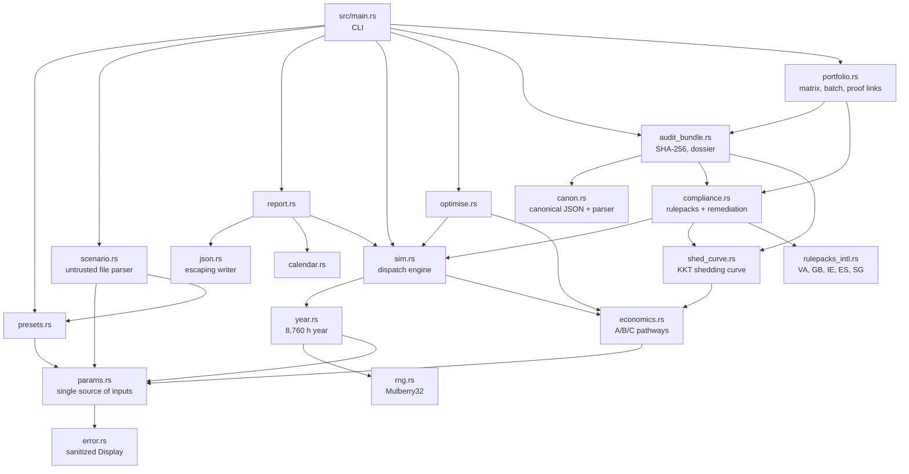
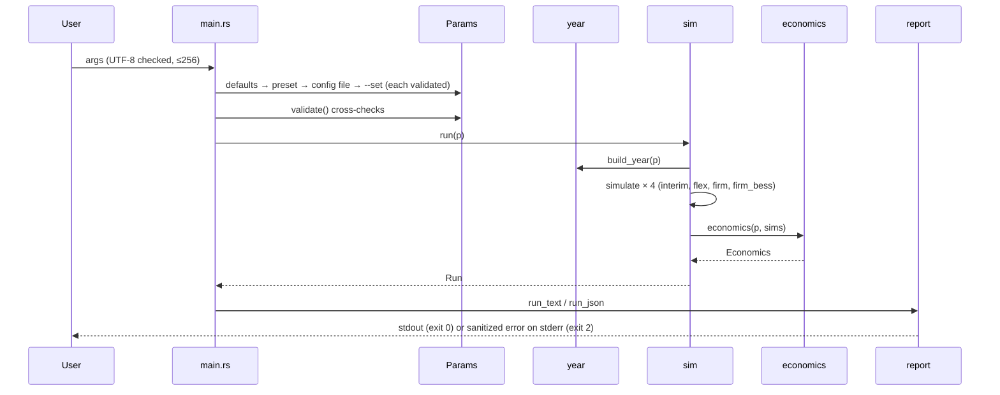
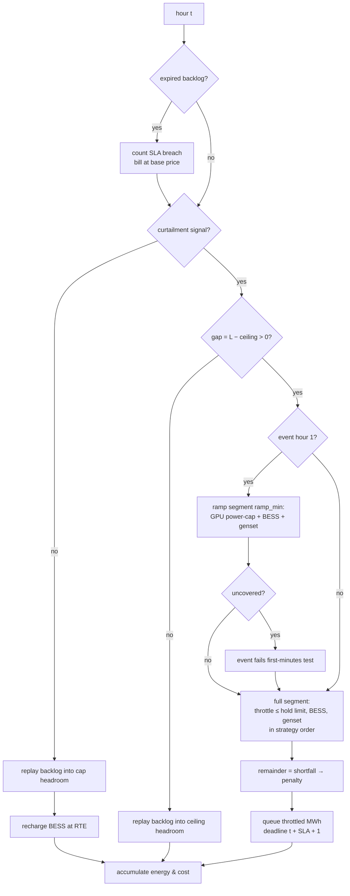
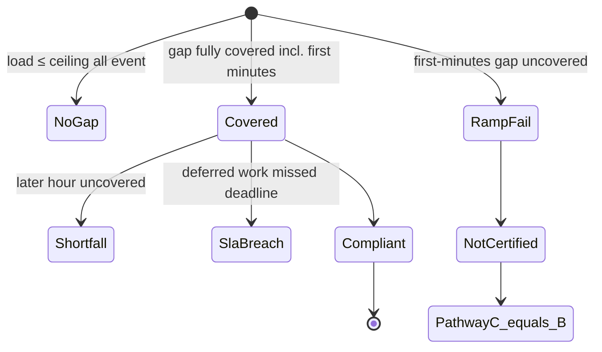

# Architecture

This document maps how the code fits together. Diagrams are Mermaid, which GitHub renders inline.

## 1. Module dependency graph



There are no cycles, and every arrow points toward leaf modules with no I/O. Only `main.rs` and
`scenario::read_file` touch the operating system.

## 2. Data flow of `firmgap run`



## 3. Dispatch decision flow (one hour, compliance mode)



## 4. Event and certification state machine



A single `RampFail` anywhere in the year makes `certified = false`. Pathway C then collapses to B
(interim-only). This models a utility witness test.

## 5. Pathway phasing

```mermaid
gantt
  dateFormat  X
  axisFormat  M%s
  section A wait
  0 MW            :a1, 0, 38
  45 MW firm      :a2, 38, 60
  section B interim
  0 MW            :b0, 0, 4
  22 MW non-firm  :b1, 4, 38
  45 MW firm      :b2, 38, 60
  section C bridge
  0 MW            :c0, 0, 4
  22 MW interim   :c1, 4, 10
  45 MW non-firm + BESS :crit, c2, 10, 38
  45 MW firm + arbitrage :c3, 38, 60
```



## 6. Two implementations, one model

```mermaid
flowchart LR
  W[web/index.html<br/>FIRMGAP-CORE block] -- node scripts/golden.mjs --check --> G[(tests/golden.json)]
  G -- values embedded in --> T[tests/golden.rs]
  T -- cargo test --> RS[src/*.rs]
```

CI fails if either side drifts. See [CONTEXT_MAP.md](CONTEXT_MAP.md#changing-the-model) for the
change procedure.
